<!-- Profile README for github.com/Kavin-124 -->

  

  <h2>Hi, I'm Kavin 👋</h2>
  
Information Technology student focused on building useful web applications and solving practical problems through software.

  
  
  

---

## About

- 🎓 B.Tech Information Technology student at V.S.B. Engineering College
- 💻 Interested in software engineering and full-stack web development
- 🌱 Currently strengthening Java, JavaScript, SQL and application development skills
- 🧩 Enjoy building projects that address real-world use cases
- 🤝 Open to learning opportunities, collaboration and entry-level developer roles

## Tech Stack

**Languages**

**Frameworks, Tools & Platforms**

---

## Featured Projects

### [DayFlow — Human Resource Management System](https://github.com/Kavin-124/DayFlow)
A web-based HRMS for employee administration and workforce workflows, including attendance, leave approvals, payroll management and data exports.

**Built with:** Next.js, TypeScript, React, Prisma, SQLite, Tailwind CSS  
[Live Demo](https://day-flow-hrm.vercel.app/)

### [LifePulse — Emergency Medical & First-Responder Network](https://github.com/Kavin-124/lifepulse-emergency)
A PWA concept that helps make essential emergency information accessible, with QR-based medical profiles, emergency location sharing, hospital discovery and offline-oriented support.

**Built with:** HTML, CSS, JavaScript, Node.js, Express.js, PWA  
[Live Demo](https://lifepulse-emergency.vercel.app/)

### [ResQRoute — Emergency Routing & Telematics Simulator](https://github.com/Kavin-124/ResQRoute)
An interactive map-based simulator for emergency transport scenarios, featuring Tamil Nadu district routes, ambulance movement, traffic visualization and escort-vehicle simulation.

**Built with:** HTML, CSS, JavaScript, Leaflet, OpenStreetMap  
[Live Demo](https://res-q-route-red.vercel.app/)

### [AI Timetable](https://github.com/Kavin-124/AI_Timetable)
An academic scheduling project exploring timetable generation and conflict-aware scheduling.

---

## Achievements

- 🥈 Second Prize — National Level Symposium 2024
- 📜 NPTEL Certificate — Python

## GitHub Activity

  

  <picture>
    <source media="(prefers-color-scheme: dark)" srcset="https://raw.githubusercontent.com/Kavin-124/Kavin-124/output/github-contribution-grid-snake-dark.svg"/>
    <source media="(prefers-color-scheme: light)" srcset="https://raw.githubusercontent.com/Kavin-124/Kavin-124/output/github-contribution-grid-snake.svg"/>
    
  </picture>

---

  <i>Always learning. Building with purpose. Improving one commit at a time.</i>

